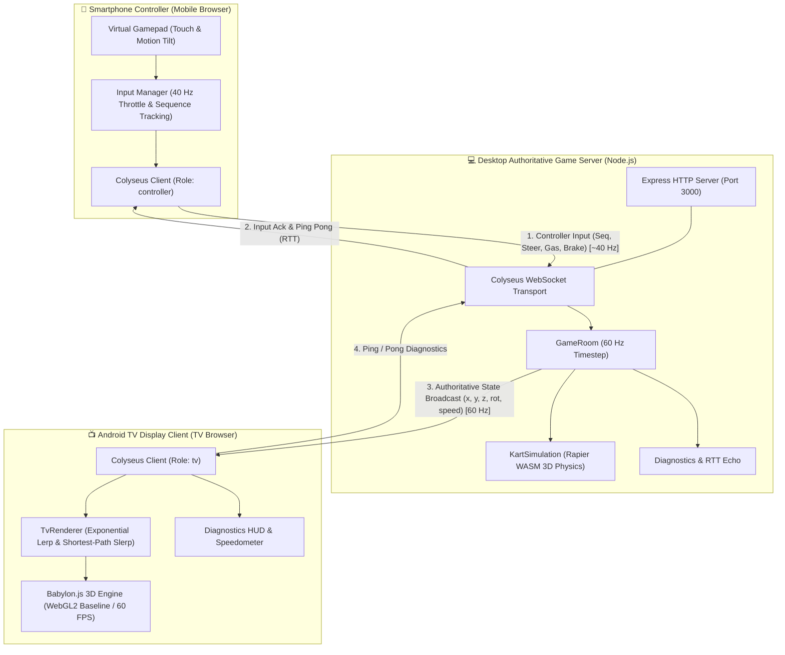

# 🏎️ Kart Party – Technical Architecture Proof-of-Concept (PoC)

> **Authoritative browser-based real-time multiplayer kart racing architecture over local Wi-Fi.**  
> Built with **TypeScript**, **Node.js**, **Babylon.js**, **Rapier WASM**, **Colyseus**, and **Vite**.

---

## 1. Executive Summary & Objective

This project is a functional, minimalistic technical proof-of-concept (PoC) validating a tri-device local-network multiplayer gaming topology:

1. **Desktop Server**: Hosts the authoritative game room, steps a fixed 60 Hz simulation loop with Rapier WASM 3D collision bounds, processes compact controller inputs, and broadcasts authoritative state.
2. **Android TV Client**: Opens `http://<LAN_IP>:3000/tv` in an Android TV browser, rendering a real-time 3D racetrack and kart in **Babylon.js** (WebGL2 baseline) with frame-rate independent interpolation.
3. **Smartphone Controller**: Opens `http://<LAN_IP>:3000/controller` (via on-screen QR code), streaming compact virtual gamepad inputs (steer left/right, gas, brake, optional motion tilt) at ~40 Hz.

**Important Note**: This is a pure architectural PoC. It deliberately omits character selection, weapons, power-ups, AI, multiple tracks, audio, user accounts, and databases to focus exclusively on network latency, authoritative simulation, and cross-device synchronization over local Wi-Fi without cloud dependencies.

---

## 2. Architecture Overview



---

## 3. Technology Stack & Verified Versions

| Component | Technology | Version | Purpose |
| :--- | :--- | :--- | :--- |
| **Language** | TypeScript | `^7.0.2` | End-to-end static typing and protocol contracts |
| **Runtime** | Node.js | `>=20.x` (Tested v22.11) | Server hosting and game loop execution |
| **Multiplayer / Networking** | Colyseus | `^0.18.12` | Room management, WebSocket transport, state sync |
| **Multiplayer Client SDK** | `@colyseus/sdk` | `^0.18.10` | Client WebSocket connection and sequence handling |
| **3D Rendering** | Babylon.js (`@babylonjs/core`) | `^9.36.0` | 3D scene, track boundaries, kart mesh, camera |
| **Physics / Collision** | Rapier WASM (`@dimforge/rapier3d-compat`) | `^0.21.0` | Fixed 60Hz physics world and track perimeter colliders |
| **Frontend Bundler** | Vite | `^6.4.6` | Client production bundling and development server |
| **HTTP Framework** | Express | `^5.3.0` | LAN discovery API, static file hosting, QR endpoints |
| **QR Code Generator** | `qrcode` | `^1.5.4` | Terminal ASCII QR and in-game TV scan modal |

---

## 4. Project Directory Structure

```
MarioCart/
├── package.json               # Scripts and production dependencies
├── tsconfig.json              # TypeScript compilation configuration
├── vite.config.ts             # Multi-page Vite bundling config (tv, controller, hub)
├── index.html                 # Architecture Web Hub & QR pairing landing page
├── tv.html                    # Android TV Babylon.js 3D Game Client entrypoint
├── controller.html            # Smartphone Virtual Gamepad interface entrypoint
├── src/
│   ├── shared/
│   │   ├── game-types.ts      # Shared interfaces (KartState, ControllerInput, Diagnostics)
│   │   └── protocol.ts        # Constants, Colyseus schemas, and input validation
│   ├── server/
│   │   ├── server.ts          # Express + Colyseus server, LAN IP discovery, QR output
│   │   ├── game-room.ts       # Authoritative room: 60Hz loop, client roles, ping/pong RTT
│   │   └── simulation.ts      # Rapier 3D world, perimeter colliders, arcade movement model
│   ├── tv/
│   │   ├── main.ts            # TV client orchestration, WebSocket connection, HUD updates
│   │   ├── scene.ts           # Babylon.js 3D meshes (kart body, wheels, track, lighting)
│   │   ├── renderer.ts        # Independent rendering loop with smooth interpolation
│   │   └── diagnostics.ts     # FPS counter, state interval, RTT and backend detection
│   └── controller/
│       ├── main.ts            # Phone client entrypoint, Colyseus room pairing, diagnostics
│       ├── controller.ts      # Touch button bindings (multi-touch) and motion tilt sensor
│       └── input.ts           # Input packet batching (40 Hz), sequence tracking, validation
├── test/
│   └── poc-verification.ts    # Automated 21-point architecture verification test
└── README.md                  # Comprehensive architectural guide & test report
```

---

## 5. Quick Start Instructions

### Prerequisites
- **Node.js** v20.x or v22.x installed on your desktop.
- Desktop and mobile devices connected to the **same local Wi-Fi network**.

### Step 1: Install Dependencies
```bash
npm install
```

### Step 2: Build the Client Bundle
```bash
npm run build
```
*(Builds the multi-page static application into `dist/client/`)*

### Step 3: Run the Server
```bash
npm start
```

Upon launch, the server terminal will output:
```
============================================================
 🏎️  KART PARTY – Real-Time Technical Architecture PoC
============================================================
 🌐 Server LAN IP:      192.168.1.8
 📺 TV Game Client:     http://192.168.1.8:3000/tv
 📱 Mobile Controller:  http://192.168.1.8:3000/controller
 💻 Web Hub / Info:     http://192.168.1.8:3000
============================================================
 📲 SCAN WITH PHONE TO OPEN CONTROLLER:
 [Terminal ASCII QR Code]
============================================================
 Ready for TV and Phone connections. Press Ctrl+C to stop.
```

---

## 6. Device Connection Guide

### A. Android TV Browser Connection
1. Ensure your Android Smart TV is connected to the same Wi-Fi network as the desktop.
2. Open a web browser on Android TV (e.g. **Open TV Browser**, **JioPages**, **Silk**, **Puffin**, or **Chrome**).
3. Type the TV URL displayed in the server terminal:
   ```
   http://<DESKTOP_LAN_IP>:3000/tv
   ```
   *(Example: `http://192.168.1.8:3000/tv`)*
4. The TV will display the 3D racetrack, Babylon.js kart, diagnostics HUD, and a **"Scan to Drive"** QR code modal.
5. Click the **⛶ Fullscreen** button (via TV remote cursor or mouse) to enter immersive fullscreen.

### B. Smartphone Controller Connection
1. Open the camera or any QR scanner on your smartphone.
2. Scan the QR code displayed either:
   - On the **Android TV screen**, OR
   - Directly in the **Desktop terminal console**, OR
   - Navigate manually to `http://<DESKTOP_LAN_IP>:3000/controller`.
3. The phone interface loads instantly with a responsive virtual gamepad:
   - **LEFT [◀] / RIGHT [▶]**: Steers the kart.
   - **GAS [▲]**: Accelerates forward up to 80 km/h.
   - **BRAKE [■]**: Decelerates / brakes (or reverses from stationary).
   - **↺ Reset**: Returns kart to center track.
4. As soon as the phone connects, the TV's QR overlay automatically fades away, and the kart responds immediately to your touch!

---

## 7. LAN Networking & Sensor Permissions (HTTPS vs HTTP)

### Local Wi-Fi Firewall Note
On Windows, ensure your firewall permits Node.js inbound TCP traffic on port 3000:
- If prompted by Windows Defender Firewall, select **"Allow access on Private networks"**.
- You can verify port connectivity from any device by accessing `http://<DESKTOP_LAN_IP>:3000/api/info`.

### DeviceOrientation Motion Sensor Security Policy
- **Touch Controls**: Work 100% reliably out-of-the-box over plain **HTTP** (`http://<LAN_IP>:3000/controller`). No certificates, tunnels, or flags needed.
- **Motion Steering (DeviceOrientation)**:
  - Modern mobile browsers (iOS 13+ Safari and Chromium Android 110+) enforce the **Secure Context specification** (`window.isSecureContext === true`) for hardware sensor APIs (`DeviceOrientationEvent` and `DeviceMotionEvent`).
  - When accessing via plain HTTP over a LAN IP (e.g. `http://192.168.1.8:3000`), the browser disables sensor event dispatch.
  - In this PoC, the controller detects sensor availability. If accessed via HTTP, it displays:
    `Touch Controls Active (Motion Sensor requires HTTPS or is unsupported)`.

#### Optional: Enabling HTTPS on Local Wi-Fi
If you wish to test motion tilt steering on a physical smartphone:
1. **Option 1: Chrome Flag on Android**:
   On your phone's Chrome browser, navigate to:
   `chrome://flags/#unsafely-treat-insecure-origin-as-secure`
   Enter your desktop LAN address: `http://192.168.1.8:3000`, enable the flag, and restart Chrome. This enables device sensors over HTTP!
2. **Option 2: Local SSL with `mkcert`**:
   Install `mkcert` (`mkcert -install && mkcert 192.168.1.8 localhost`), and supply the certificate to Node.js `https.createServer()`.

---

## 8. Authoritative Simulation & Protocol Details

### Fixed 60 Hz Simulation Timestep
The simulation runs independently of client rendering at $\Delta t = 1/60 \approx 16.66$ ms.
- **Forward Kinematics**:
  $$\text{speed} \leftarrow \text{speed} + a \cdot \text{throttle} \cdot \Delta t$$
  $$x \leftarrow x + \sin(\theta) \cdot \text{speed} \cdot \Delta t$$
  $$z \leftarrow z + \cos(\theta) \cdot \text{speed} \cdot \Delta t$$
- **Angular Kinematics**:
  $$\theta \leftarrow \theta + \text{steer} \cdot \omega_{\text{turn}} \cdot \Delta t \cdot \left(\min\left(1, \frac{|\text{speed}|}{5} + 0.25\right)\right)$$
- **Rapier WASM Colliders**:
  A 3D physics world (`RAPIER.World`) maintains rigid body cuboid bounds for the 4 track perimeters ($80\text{m} \times 50\text{m}$) and the kart's kinematic body. Collision against boundary colliders reverses velocity ($v \leftarrow -0.2v$) and enforces strict position clamping inside the circuit boundaries.

### Network Message Payload Formats

**Controller Input Packet (Phone $\to$ Server, ~40 Hz)**:
```json
{
  "type": "input",
  "sequence": 142,
  "steering": -0.85,
  "throttle": 1.0,
  "brake": false,
  "clientTime": 1731612450123
}
```

**Authoritative Game State Broadcast (Server $\to$ TV, 60 Hz)**:
```json
{
  "type": "state",
  "tick": 894,
  "serverTime": 1731612450140,
  "lastAckSequence": 142,
  "kart": {
    "x": 4.12,
    "y": 0.25,
    "z": 18.76,
    "rotation": -0.42,
    "speed": 14.8
  }
}
```

**RTT Measurement (Ping / Pong, 2 Hz)**:
- Phone / TV sends: `{"type": "ping", "clientTime": performance.now()}`
- Server responds immediately: `{"type": "pong", "clientTime": ..., "serverTime": Date.now()}`
- Measured RTT is: `RTT = performance.now() - clientTime`.
- Estimated 1-way latency: $\text{RTT} / 2$.

---

## 9. Automated PoC Verification Test

An end-to-end automated test suite validates the entire architecture without requiring manual browser interaction:

```bash
npx tsx test/poc-verification.ts
```

### Verified Acceptance Criteria:
```
--- 1. Testing HTTP Server & Client Hosting ---
  ✅ [PASS] GET /api/info returns 200 OK 
  ✅ [PASS] API returns valid LAN IP, URLs and QR Code 
  ✅ [PASS] GET /tv returns 200 OK 
  ✅ [PASS] TV HTML contains 3D canvas and HUD 
  ✅ [PASS] GET /controller returns 200 OK 
  ✅ [PASS] Controller HTML contains touch controls 
  ✅ [PASS] GET / returns 200 OK landing page 

--- 2. Testing Colyseus Real-Time Room & Roles ---
  ✅ [PASS] TV client successfully connected to game room
  ✅ [PASS] TV receives 60Hz authoritative state broadcasts from server 
  ✅ [PASS] Phone controller connected to game room

--- 3. Testing Network RTT Ping / Pong ---
  ✅ [PASS] Measured RTT ping/pong successful (RTT: 2.13 ms)

--- 4. Testing Authoritative Arcade Driving Simulation ---
  ✅ [PASS] Server acknowledged sequence #1 input from phone
  ✅ [PASS] Kart speed accelerated above 0 (speed: 5.60 m/s)
  ✅ [PASS] Kart authoritative Z position moved forward on TV (z: 1.12)
  ✅ [PASS] Server acknowledged sequence #2 input
  ✅ [PASS] Kart rotated left in response to steering input (rotation: -0.185 rad)
  ✅ [PASS] Server acknowledged sequence #3 input 
  ✅ [PASS] Kart rotated right in response to steering input (rotation: 0.210 rad)
  ✅ [PASS] Server acknowledged sequence #4 input 
  ✅ [PASS] Holding BRAKE slows down the kart (speed: 8.81 m/s)
  ✅ [PASS] Server acknowledged release of controls (#5)

--- 5. Testing Disconnect & Reconnect Resiliency ---
  ✅ [PASS] TV notified when phone disconnects (shows QR modal)
  ✅ [PASS] Phone successfully reconnected with new session
  ✅ [PASS] TV notified when phone reconnected (hides QR modal)
  ✅ [PASS] Reconnected phone immediately regains authoritative kart control

======================================================
📊 TEST RESULTS: 21 / 21 TESTS PASSED (100%)
======================================================
```

---

## 10. Android TV Physical Compatibility Testing Protocol

> **Pre-test Notice**: Per project instructions, compatibility and performance on physical Android TV hardware must be verified through manual testing rather than claimed theoretically. Use this protocol to test and record results.

### Physical Testing Setup
1. **Target Hardware**: Physical Android TV / Google TV device (e.g. Sony Bravia, TCL Google TV, Chromecast with Google TV, Xiaomi Mi Box, or Amazon Fire TV).
2. **Browser Selection**:
   - Sideloaded Google Chrome or Chromium (recommended).
   - "Open TV Browser" / "JioPages" / "Puffin TV" from Android TV Play Store.
   - Amazon Silk Browser (on Fire TV).
3. **Execution Steps**:
   - Connect TV to same 5 GHz Wi-Fi band as the desktop.
   - Enter `http://<DESKTOP_LAN_IP>:3000/tv`.
   - Verify 3D racetrack and kart render correctly.
   - Connect smartphone by scanning TV screen QR code.
   - Steer kart around the circuit for 3 continuous minutes.
   - Disconnect phone (toggle Airplane Mode), verify TV reflects status, toggle phone back on and verify control restoration.

---

## 11. Performance Test Report Template

Use this template to document benchmark findings during physical test runs:

| Test Parameter | Specification / Threshold | Measured Value | Result |
| :--- | :--- | :--- | :--- |
| **TV Display Device** | Hardware Model (e.g., Chromecast 4K) | *[Record Device]* | - |
| **TV Browser App** | Browser Name & Version | *[Record Browser]* | - |
| **TV Graphics Backend** | WebGL2 Baseline | *[WebGL2 / WebGL1]* | Pass / Fail |
| **TV Rendering FPS** | Target: 60 FPS (Min $\ge 45$ FPS) | *[Measured FPS]* | Pass / Fail |
| **Desktop CPU Processing** | $< 1.0$ ms per simulation tick | *[Measured CPU ms]* | Pass / Fail |
| **Simulation Rate** | Fixed 60 Hz ($\pm 2$ Hz) | *[Measured Hz]* | Pass / Fail |
| **Controller Input Rate** | Target: 35–45 Hz | *[Measured Hz]* | Pass / Fail |
| **Network Measured RTT** | $< 35$ ms over 5 GHz Wi-Fi | *[Measured RTT ms]* | Pass / Fail |
| **Visual Interpolation** | Motion appears smooth without jitter | *[Smooth / Jittery]* | Pass / Fail |
| **Disconnect Recovery** | Phone disconnects $\to$ Reconnects $< 3$s | *[Measured Sec]* | Pass / Fail |
| **Subjective Input Lag** | Perceived delay from touch to movement | *[Instant / Perceptible / Laggy]* | Pass / Fail |

---

## 12. Known Limitations & Architectural Boundaries

1. **Local Wi-Fi Only**: Operates strictly on a shared LAN subnet without STUN/TURN, NAT traversal, or cloud relay services.
2. **Single Controller Focus**: Validates 1 active controller and 1 kart. Multi-kart room orchestration and grid placement are left for subsequent milestone phases.
3. **Simplified Arcade Dynamics**: Integrates Rapier 3D colliders for perimeter constraints, but uses a kinematic arcade drive model rather than a complex raycast wheel suspension simulation.
4. **Motion Sensor Scope**: Motion tilt relies on browser `DeviceOrientationEvent` which requires HTTPS on modern mobile browsers. Touch controls are completely self-contained and remain the primary, guaranteed control scheme.
